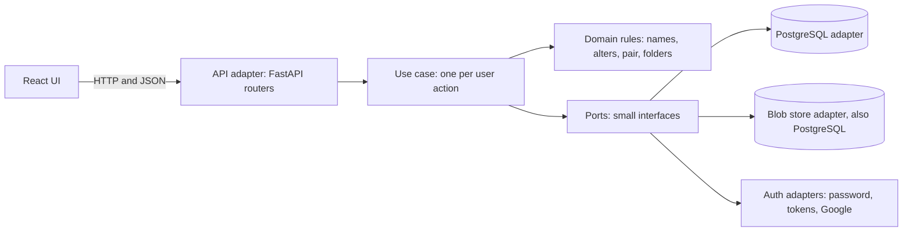
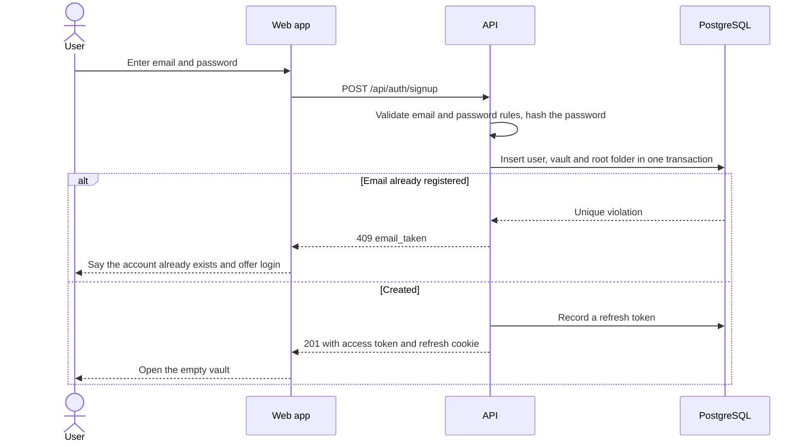
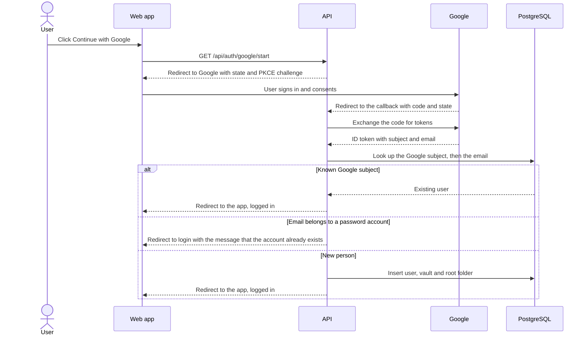
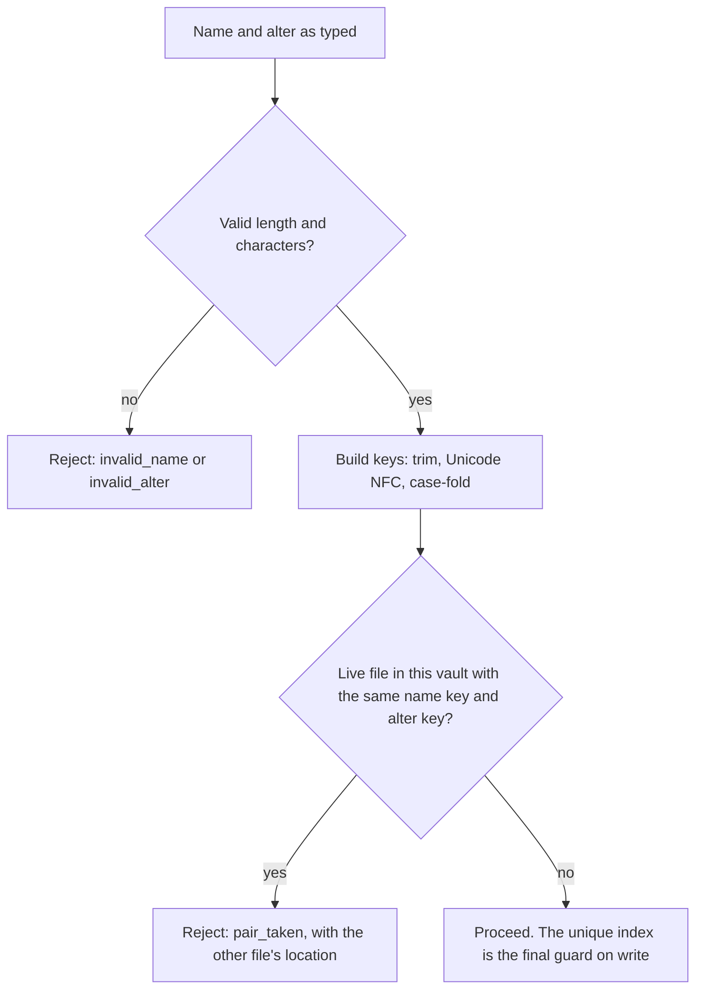
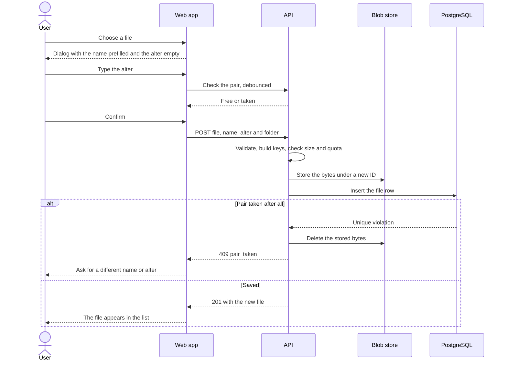
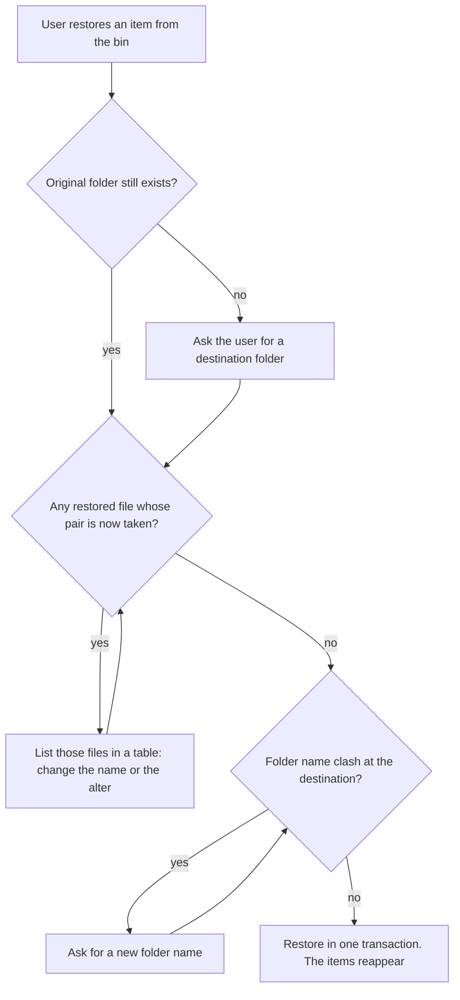

# Flows

How the app behaves, step by step, for every user action in v1. Diagrams are Mermaid and render on GitHub and in most Markdown viewers.

- Decision IDs (D-0xx) refer to `DECISIONS.md`. A flow that leans on a **Proposed** decision may change when that decision is confirmed.
- Story IDs (E0x-S0x) refer to `issues/`.
- Endpoint paths are illustrative until the API stories fix them.

**Contents**

1. [How a request travels through the layers](#1-how-a-request-travels-through-the-layers)
2. [Accounts](#2-accounts)
3. [Browsing](#3-browsing)
4. [The pair rule](#4-the-pair-rule)
5. [Files](#5-files)
6. [Folders](#6-folders)
7. [Recycle bin](#7-recycle-bin)
8. [Search and jump](#8-search-and-jump)
9. [Drag and drop](#9-drag-and-drop)
10. [Thumbnails](#10-thumbnails)

---

## 1. How a request travels through the layers

Decisions: D-024, D-037. Stories: E01-S02, E01-S06.

1. The router checks the access token, finds the caller's vault and turns the request into a call on one use case.
2. The use case asks the domain to validate and decide, then reads and writes through ports.
3. Adapters do the actual work against PostgreSQL and Google.
4. Errors come back as domain errors, and the router maps each to one error code in the response.

---

## 2. Accounts

### 2.1 Sign up with email and password

Decisions: D-009, D-010, D-029, D-030. Stories: E02-S01, E02-S02, E02-S06.

### 2.2 Log in, stay logged in, log out

Decisions: D-029, D-030. Stories: E02-S03, E02-S06.

1. The user submits email and password.
2. The API finds the account by its case-insensitive email and checks the password hash.
3. On failure the response is the same generic "wrong email or password" whether or not the email exists, and the attempt counts toward a rate limit.
4. On success the API returns a short-lived access token and sets a refresh token in an httpOnly cookie. The refresh token is recorded in the database.
5. The web app keeps the access token in memory and sends it with every request. The API reads the user and vault from it.
6. When the access token expires, or the page is reloaded, the web app exchanges the refresh cookie for a new access token. The refresh token is replaced each time it is used.
7. If the refresh fails, the web app shows the login screen.
8. Log out revokes the refresh token in the database and clears the cookie.

### 2.3 Google sign-in

Decisions: D-010, D-029, D-030. Story: E02-S04.

Accounts are never linked automatically, and v1 has no setting to connect Google to a password account (D-030, D-042).

### 2.4 Change password

Decisions: D-029, D-042. Stories: E02-S07, E02-S06.

1. A logged-in user opens account settings and enters the current password and a new one.
2. The API checks the current password, applies the password rules and saves the new hash.
3. Refresh tokens on the user's other devices are revoked, so those devices are logged out.
4. Accounts created through Google have no password and are not offered this setting.

### 2.5 Forgotten password (not in v1)

Decisions: D-031. Stories: E02-S08, E02-S05, E10-S03.

v1 sends no email, so there is no self-service reset. A developer resets a password from the command line (E02-S08). Reset by emailed link arrives with hosting (E10-S03).

---

## 3. Browsing

### 3.1 Open a folder

Decisions: D-003, D-011. Stories: E04-S04, E08-S01, E08-S02.

1. The address bar carries the current folder, so a link or a refresh returns to the same place.
2. The web app requests that folder's listing with the current sort column and direction.
3. The API confirms the folder belongs to the caller's vault and returns the breadcrumb path, the subfolders and the files (name, alter, type, size, modified, whether a thumbnail exists).
4. Folders are shown before files. Large folders arrive a page at a time as the user scrolls.
5. The tree pane loads a folder's children only when it is expanded.
6. Double-clicking a folder opens it. Double-clicking a file downloads it, because v1 has no preview.

### 3.2 Sort and switch view

Stories: E08-S02, E08-S04.

1. Clicking a column header sorts by it, and clicking again reverses the order. Alter sorts like any other column.
2. A toggle switches between the details list and the thumbnail grid. The browser remembers the choice.
3. Selection and right-click actions behave the same in both views.

### 3.3 On a phone

Decisions: D-043, D-046. Applies to every UI story.

1. Every screen works at phone width. How each one rearranges is decided in its own story.
2. A long-press opens the menu that a right-click opens on desktop.
3. Moves are available through "Move to" in that menu, as well as by dragging.
4. Uploads start from the file picker, since there is no desktop to drop from.
5. Keyboard shortcuts are a desktop extra, and nothing depends on them.

---

## 4. The pair rule

### 4.1 Checking a pair

Decisions: D-002, D-005, D-006, D-027, D-032. Stories: E03-S01, E03-S02, E03-S03.

- Same name with a different alter passes. Same alter with a different name passes.
- Files in the bin are not live, so they do not block a pair (D-008).
- The folder plays no part.

### 4.2 Two requests racing for the same pair

1. Both requests pass the check in 4.1 because neither has written yet.
2. Both try to write. The partial unique index lets exactly one commit.
3. The other receives a unique violation, which the repository turns into the domain's pair-taken error.
4. The losing use case removes any bytes it already stored and returns `pair_taken`.

---

## 5. Files

### 5.1 Upload one file

Decisions: D-001, D-004, D-028, D-036. Stories: E05-S01, E05-S02, E08-S06.

The bytes and the file row both live in PostgreSQL (D-028), so the two writes can share one transaction; E05-S01 decides. Thumbnails are not made at upload (section 10).

### 5.2 Upload several files

Decisions: D-012, D-037. Stories: E05-S03, E08-S06.

1. The user selects or drops several files.
2. A table shows one row per file: name (prefilled from the file), alter (empty) and status.
3. Optionally the user opens the pattern helper, types a prefix and a starting number, and the helper fills the empty alters. Every row stays editable.
4. The web app marks rows with an empty alter and rows that duplicate another pair in the same batch.
5. The web app asks the API whether each pair is free in the vault and marks the taken ones.
6. The upload button is enabled only when every row is valid and free.
7. Files upload one request each, a few at a time, and each row shows its progress.
8. A row that fails (pair taken in the meantime, file too large, quota reached) stays in the table with its reason. The other rows finish.
9. The user fixes the failed rows and retries only those.

### 5.3 Download

Decisions: D-039. Stories: E05-S04, E05-S08.

- **One file:** the API confirms the file is in the caller's vault and streams the bytes with the file's name as the download name.
- **Several items:** the API streams one zip. When two entries would share a name inside the zip, ` [alter]` is added before the extension of each.

### 5.4 Rename a name or an alter

Decisions: D-002, D-005. Stories: E05-S05, E08-S07.

1. The user edits the name (F2 or the menu) or the alter (its own cell or the menu).
2. The web app checks the new pair as the user types.
3. The API validates, rebuilds the keys and updates the row.
4. If another live file holds the new pair, the response is `pair_taken` with that file's location, and the edit stays open.
5. Changing only the capitalisation of a file's own name or alter always succeeds, because the keys do not change.

### 5.5 Move

Decisions: D-002, D-039. Stories: E05-S06, E04-S03, E08-S07.

- **Files:** the user picks a destination folder, or drags onto one. The API confirms the destination is a live folder in the same vault and updates the files. No pair check is needed, because the folder plays no part in the rule.
- **Folders:** see 6.2.

### 5.6 Copy

Decisions: D-004, D-039. Stories: E05-S07, E08-S07.

1. The user chooses Copy and a destination.
2. For one file, a dialog shows the name (editable) and an empty alter box. For several, the table from 5.2 is used, including the pattern helper.
3. The API creates a new file row with the new pair and its own copy of the bytes, subject to the quota.
4. A copy that keeps the original pair is refused with `pair_taken`.
5. Copying a folder is not available in v1 (E10-S07).

---

## 6. Folders

### 6.1 Create and rename

Decisions: D-007, D-032. Stories: E04-S01, E04-S02.

1. New folder creates a folder in the current location and puts its name straight into edit mode.
2. The API validates the name and checks no live sibling folder has the same name, ignoring case.
3. A clash returns `folder_name_taken` and the name stays in edit mode.
4. Rename follows the same check. The vault's root folder cannot be renamed, moved or deleted.

### 6.2 Move a folder

Decisions: D-039. Story: E04-S03.

1. The user picks a destination or drags the folder onto one.
2. The API refuses a move into the folder itself or any of its descendants.
3. If the destination already has a folder of that name, the response is `folder_name_taken` and the web app asks for a new name before retrying.
4. Files inside are untouched, and their pairs cannot collide.

---

## 7. Recycle bin

### 7.1 Delete

Decisions: D-008, D-035. Stories: E06-S01, E06-S02, E08-S11.

1. The user deletes one or more items with the Delete key or the menu.
2. The API marks each file as deleted. A folder is marked together with everything inside it, as one unit.
3. The items disappear from listings and search, and their pairs become free immediately.
4. The bin lists each deleted item with its name, alter, original location and deletion date. A deleted folder shows as one entry.

### 7.2 Restore

Decisions: D-008, D-035. Stories: E06-S03, E08-S11.

A restore with no conflicts is a single step.

### 7.3 Permanent delete and empty bin

Decisions: D-035. Story: E06-S04.

1. The user permanently deletes one bin item, or empties the bin, and confirms.
2. The API removes the rows, then the bytes and thumbnails from the blob store.
3. The vault's used space drops accordingly. Nothing can be restored after this.

---

## 8. Search and jump

### 8.1 Search

Decisions: D-003, D-033. Stories: E07-S01, E08-S12.

1. The user types in the search box.
2. The API matches the text, ignoring case, against file names, alters and folder names across the whole vault, leaving out the bin.
3. Results show name, alter and location. "Open location" goes to the containing folder with the item selected.

### 8.2 Jump by pair

Decisions: D-002, D-033. Stories: E07-S02, E08-S12.

1. The user either opens the Go-to dialog and fills its two fields, Name and Alter, or types `name | alter` in the search box.
2. The API looks up the exact pair, ignoring case. At most one live file can match.
3. On a match the web app opens the containing folder and selects the file.
4. With no match the dialog, or the search box, says so and stays open.

---

## 9. Drag and drop

Decisions: D-011. Story: E08-S10.

- **From the desktop into the app:** dropping files on the list or on a folder opens the upload dialog for that destination (5.1 for one file, 5.2 for several). Nothing uploads until every alter is typed.
- **Inside the app:** dragging selected items onto a folder in the list, the tree or the breadcrumb moves them (5.5, 6.2). The target is highlighted while hovering, and invalid targets (the item itself, its descendants, the bin) refuse the drop.
- **On a phone:** the same uploads and moves are reachable without dragging (3.3).

---

## 10. Thumbnails

Decisions: D-028, D-034. Stories: E08-S03, E08-S04.

1. The grid view asks for thumbnails for the visible tiles only.
2. The first time a raster image (JPEG, PNG, GIF, WebP) is asked for, the backend makes a small thumbnail, stores it in PostgreSQL and returns it. Later requests reuse it.
3. If two requests arrive together for the same new image, one thumbnail is made.
4. If an image cannot be thumbnailed, that is remembered and the file shows a type icon from then on.
5. Files that are not raster images show an icon for their type.
6. Permanent delete removes the thumbnail with the file (7.3).
