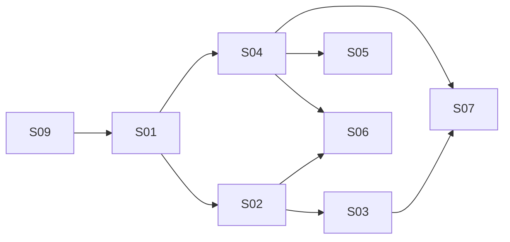

# E01 Foundation

- **Status:** Planned (specs complete; two stories wait on Proposed decisions)
- **Depends on:** None

## Outcome

A developer can start the database, API and web app with documented commands and run every check.

## Build order

E01-S09, then S01, S02, S03, S04, S05, S06, S07. S02 and S04 can be built in either order once S01 is done. S08 is already Done.

## Stories

| ID | Story | Depends on | Status |
|---|---|---|---|
| [E01-S01](E01-S01-dev-environment.md) | Developer environment | E01-S09 | Done (criterion 2 pending) |
| [E01-S02](E01-S02-backend-skeleton.md) | Backend skeleton and layering | E01-S01, E01-S09 | Done |
| [E01-S03](E01-S03-database.md) | PostgreSQL and migrations | E01-S02 | Done |
| [E01-S04](E01-S04-frontend-skeleton.md) | Frontend skeleton | E01-S01, E01-S09 | Done (browser check pending) |
| [E01-S05](E01-S05-theme-tokens.md) | Theme tokens | E01-S04 | Done (browser checks pending) |
| [E01-S06](E01-S06-api-contract.md) | API contract and typed client | E01-S02, E01-S04 | Draft (needs D-053) |
| [E01-S07](E01-S07-test-harness.md) | Test and lint harness | E01-S03, E01-S04 | Ready |
| [E01-S08](E01-S08-ci-devcontainer.md) | CI and dev container | None | Done |
| [E01-S09](E01-S09-restructure-layout.md) | Restructure into backend/ and frontend/ | None | Done |

## Decisions made while planning (2026-11-12)

D-050 (package name `twin`, Proposed), D-051 (version pins move with their side), D-052 (how the colours are applied), D-053 (typeface, icons, single theme, API client libraries; Proposed).

## Done when

All stories are Done (D-049) and a fresh clone reaches a running API, database and web page by following the README alone.
